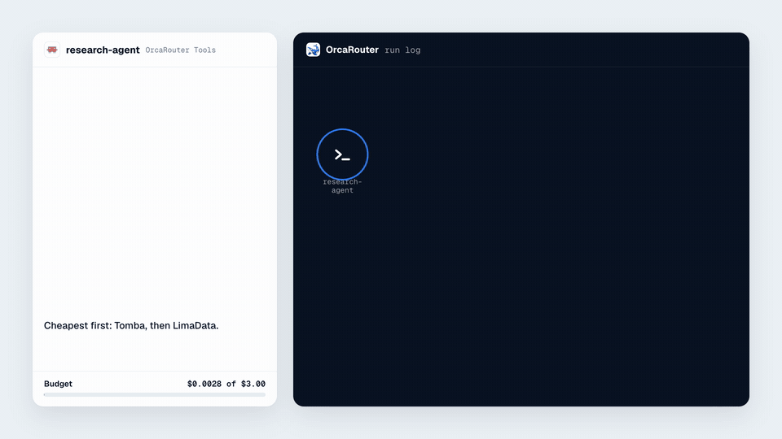
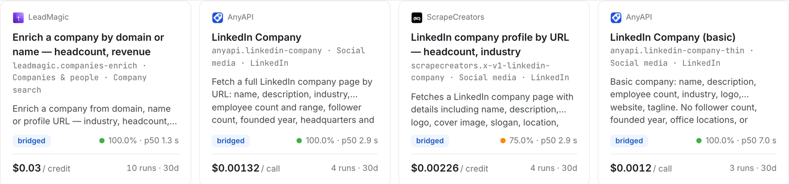
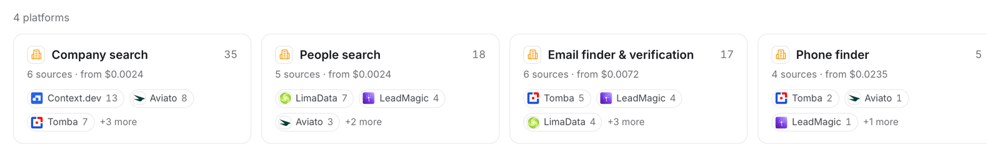
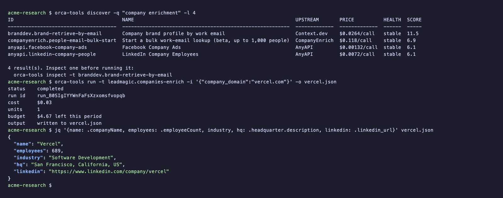
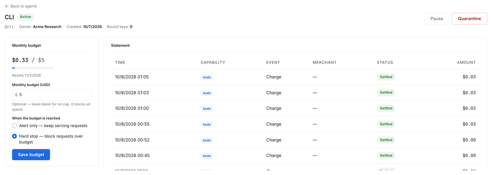
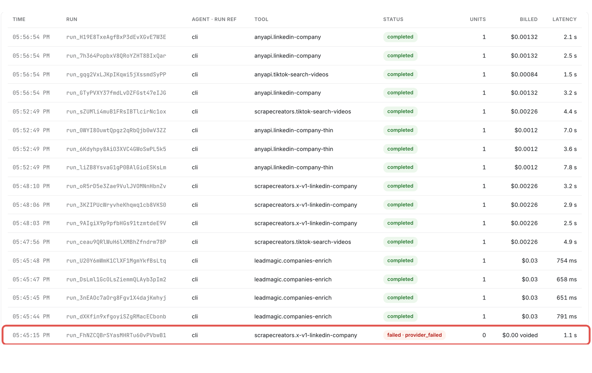

<div align="center">


# OrcaRouter Tools

**English** · [简体中文](README.zh-CN.md) · [日本語](README.ja.md) · [한국어](README.ko.md) · [Español](README.es.md)

**One API key. 1,400+ data tools your AI agent can discover, compare and run, paid per call.**

Web search, social media, company and people data, email finders, SEO, financial markets and more from 15 providers.
Your agent picks the tool, runs it and gets billed only for what it uses.

[](https://www.npmjs.com/package/@orcarouter/tools-skill)
[](https://www.npmjs.com/package/@orcarouter/cli)
[](LICENSE)

[Website](https://www.orcarouter.ai) · [Docs](https://docs.orcarouter.ai/agent-infra/tools/overview) · [Get an API key](https://www.orcarouter.ai/register?redirect=/console/token)

Works with **Claude Code** · **Codex** · **Cursor** · **OpenClaw** · **Hermes** · **opencode**, and any agent that can read a skill file.

</div>

---

## See it in action

<a href="assets/people-search.mp4"></a>

<p align="center"><a href="assets/people-search.mp4"><b>▶ Watch the 60-second demo</b></a> (MP4, with sound)</p>

> An agent is asked for the head of platform at 20 AI-infrastructure startups,
> each with a verified work email, for under $3. It finds the companies, compares
> 13 email-finder tools from 6 providers, moves to the next provider when one
> finds nothing, and asks the owner once before a call above its limit.
> Result: 20 verified emails for **$1.06**, with no subscription.
>
> <sub>Tool names and prices are real OrcaRouter list prices. Companies, people and results are illustrative.</sub>

## Why OrcaRouter Tools

- 🔑 **One key, one wallet.** One OrcaRouter API key covers every tool. The same wallet pays for your model calls too.
- 🔎 **Discover by job, not by vendor.** Ask for "company enrichment" or "tiktok posts" and get the matching tools ranked, with price, 7-day success rate and latency.
- 🔁 **Alternatives when a tool misses.** Tools that do the same job carry a `route_group`. When one fails or finds nothing, your agent lists the others and tries the next one itself.
- 💵 **Pay per call.** No subscription and no contract. Every run is quoted before it executes, and a call that fails is not billed.
- 🛡️ **Your rules on every call.** Set a budget per agent, a per-call limit and approval thresholds. Above the limit, the agent asks a human first.

## Quick start

### 1. Get an API key

[Sign up](https://www.orcarouter.ai/register?redirect=/console/token) or
[sign in](https://www.orcarouter.ai/login?redirect=/console/token). Both land on
the API key page, and a new account already has a key there. Then:

```bash
export ORCA_KEY=<your OrcaRouter API key>
```

Never paste the key into a prompt. If you skip this step, the agent walks you
through it the first time it needs a tool.

### 2. Give your agent the skill

Tell your agent:

```
set up https://cdn.jsdelivr.net/npm/@orcarouter/tools-skill/SKILL.md
```

Or install it as a Claude Code skill:

```bash
mkdir -p ~/.claude/skills/orcarouter-tools
curl -fsSL https://cdn.jsdelivr.net/npm/@orcarouter/tools-skill/SKILL.md \
  -o ~/.claude/skills/orcarouter-tools/SKILL.md
```

Then ask for what you need, for example *"find the LinkedIn page, headcount and
founding year of vercel.com, spend at most $0.10"*.

### 3. Or use the CLI

```bash
npm install -g @orcarouter/cli
orca-tools setup -k <YOUR_API_KEY>
orca-tools discover -q "company enrichment"
orca-tools run -t <toolId> -i '{"company_domain":"vercel.com"}'
```

## How it works

Your agent follows three steps, all described in [`SKILL.md`](SKILL.md):

1. **discover**: search the catalog by what you need. Each result has its price, health and, when it has substitutes, its `route_group`.
2. **inspect**: read one tool's input schema before running it.
3. **run**: the call is quoted, run and billed to your workspace wallet. The response carries the output and what it cost.

The same job usually has several providers, so your agent can compare them before it spends anything:



## What's in the catalog

Social media (TikTok, Instagram, YouTube, LinkedIn, X, Reddit, Facebook and more),
search engines and SEO, AI search visibility, companies and people, email and
phone finders, web scraping, financial markets and more.



The live catalog, with every tool's price and health, is in the [OrcaRouter console](https://www.orcarouter.ai/console).

## The CLI

`orca-tools` is the same API from a terminal, built for agents. It prints plain
text with no colour codes, has zero dependencies and needs Node 18 or later.



```
orca-tools discover -q <query> [-l <limit>] [-c <category>]
orca-tools discover -g <routeGroup>          # a tool's alternatives
orca-tools inspect  -t <toolId>
orca-tools run      -t <toolId> -i '<json>' [-o out.json]
orca-tools runs list | runs get -r <runId>
orca-tools balance
```

Full reference: [`cli/README.md`](cli/README.md).

## Spend control

Every agent has its own budget, per-call limit and approval rule, and every run
is recorded with its input, output, price and latency.



A call that fails costs nothing. It appears in the run log, voided at $0.00:



## In this repository

- **[`SKILL.md`](SKILL.md)**: the agent skill. How to discover, inspect and run tools, read errors and control spend.
  Published as [`@orcarouter/tools-skill`](https://www.npmjs.com/package/@orcarouter/tools-skill).
- **[`cli/`](cli/)**: `orca-tools`, the command-line client.
  Published as [`@orcarouter/cli`](https://www.npmjs.com/package/@orcarouter/cli).
- **[`assets/`](assets/)**: the images and the demo video used in this README.

## Links

- Documentation: [docs.orcarouter.ai/agent-infra/tools](https://docs.orcarouter.ai/agent-infra/tools/overview)
- Website: [orcarouter.ai](https://www.orcarouter.ai)

## License

[MIT](LICENSE)
